# Chain Panel 图文使用手册

这是管理自己服务器的个人控制台。先选择要做的事情，再展开确实需要的高级选项。本文截图由真实浏览器在隔离环境中生成，里面的地址、二维码和凭据只是测试示例。

## 1. 先分清三个概念

| 名称 | 是什么 | 例子 |
| --- | --- | --- |
| 服务器 | 你拥有、能安装程序的 VPS 或机器 | 香港 VPS、家里的 Linux 主机 |
| 代理接入 | 客户端通过代理访问不同目标 | 手机导入 VLESS；浏览器配置 SOCKS5 |
| 端口转发 | 固定入口指向一个固定目标 | A:20000 → B:3306 |
| 网站反代 | 按域名转发 HTTP 请求，可以终止 HTTPS | app.example.com → 127.0.0.1:3000 |
| 线路 / 路径 | 数据经过哪些服务器 | 客户端 → A → B → Internet |

**只转发端口，选择「端口转发」即可，不需要填写 VLESS、UUID 或 REALITY。** 多服务器中转时，平台自动配置内部隧道；业务客户端仍使用原来的 SSH、数据库或游戏协议。

HTTP 代理、SOCKS5 和网站反代是不同功能：前两种供代理客户端选择目标，网站反代把浏览器请求转给指定网站。“socket”通常指 SOCKS5 代理，或者普通 TCP/UDP 连接，需要按用途选择。

## 2. 安装与第一次登录

```bash
curl -fsSL https://raw.githubusercontent.com/dovetaill/vless-chain/main/scripts/install-server.sh | sudo bash
```

在线安装获取最新正式 Release。[v0.2.0 更新与升级说明](docs/releases/v0.2.0.md)列出本版功能和兼容性要求；源码构建见[高级文档](docs/advanced.md#构建)。安装支持 Linux x86_64 / aarch64、systemd、Python 3.10+、glibc 2.35+，推荐 Ubuntu 22.04+ / Debian 12+。

向导默认安装控制台和本机 Agent，只询问一个可选的面板域名：

- 留空：从网卡读取公网入站 IPv4，选未占用的随机端口，显示 `http://IP:端口`。NAT 机器需要填写实际公网入站地址。HTTP 不加密登录通信。
- 填写域名：核对公网 DNS 后配置系统 Nginx、HTTPS 和证书续期。域名需解析到本机，放行 TCP 80、443。
- 安装结束：保存控制台地址和随机生成的管理员密钥，输入密钥登录。本机服务器已自动接入。

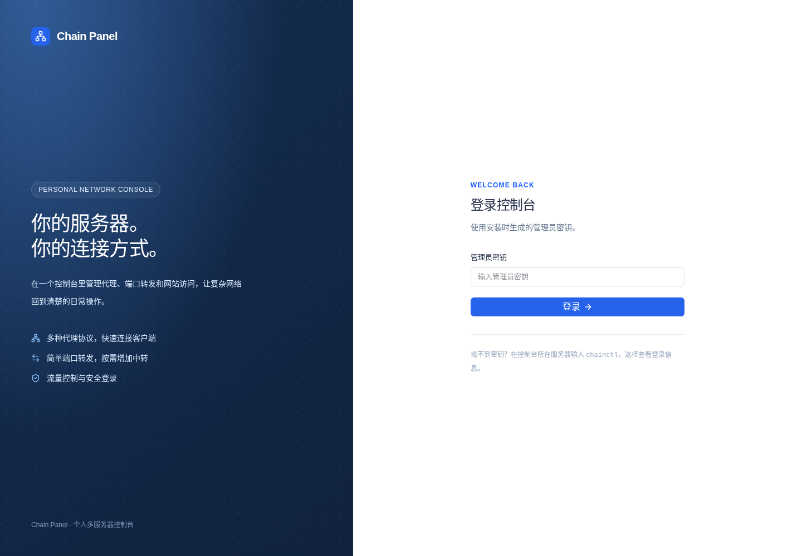

重复执行安装保留原有身份和配置。升级时先更新各台服务器的 Agent，再更新控制台，确保两者版本一致：`chainctl update --component agent`、`chainctl update --component panel`。登录信息用 `chainctl` 菜单查看。源码构建、远程 SSH 安装的发行包条件和系统目录见高级文档。

## 3. 总览与日常导航

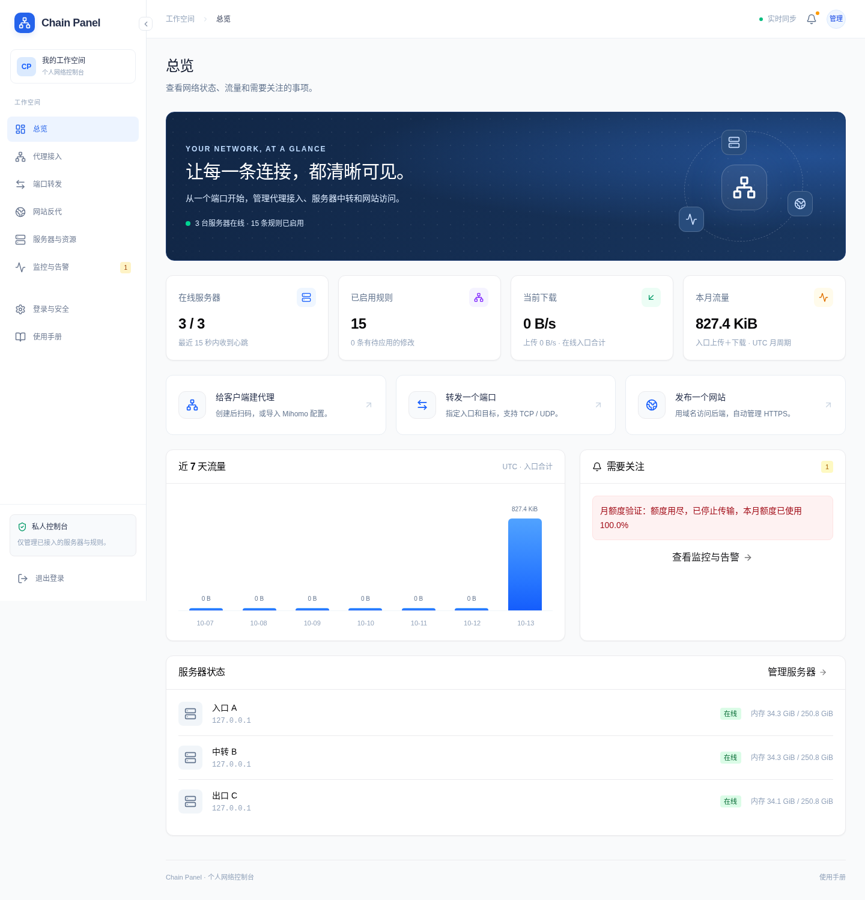

总览显示在线服务器、已应用规则、月流量、当前速度、近七天用量与告警。没有数据时显示「尚未采集」，离线数据不会伪装成实时速度。桌面点击侧栏边缘按钮收起导航，浏览器会记住选择；手机通过左上角菜单切换。

保存规则默认**保存并应用**。只有影响共享服务器的其他线路时才确认重连范围。应用结果留在当前页，失败时尝试恢复旧配置；详细记录放在「监控与告警」。需要批量修改时勾选「仅保存草稿」。

## 4. 接入自己的服务器，或使用外部资源

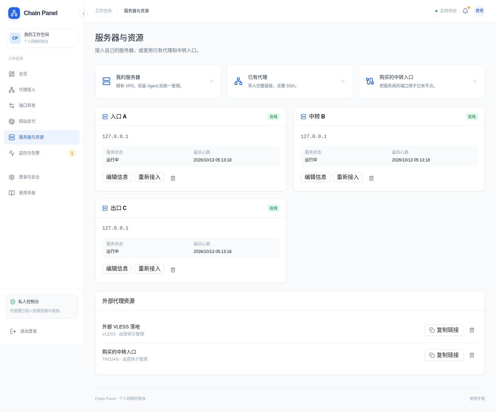

### 我有 VPS

1. 打开「服务器与资源」→「我的服务器」。
2. 填写名称、公网 IP 或域名。
3. 创建后复制安装命令，在这台服务器运行并粘贴接入码。
4. 等待显示在线，即可创建规则。

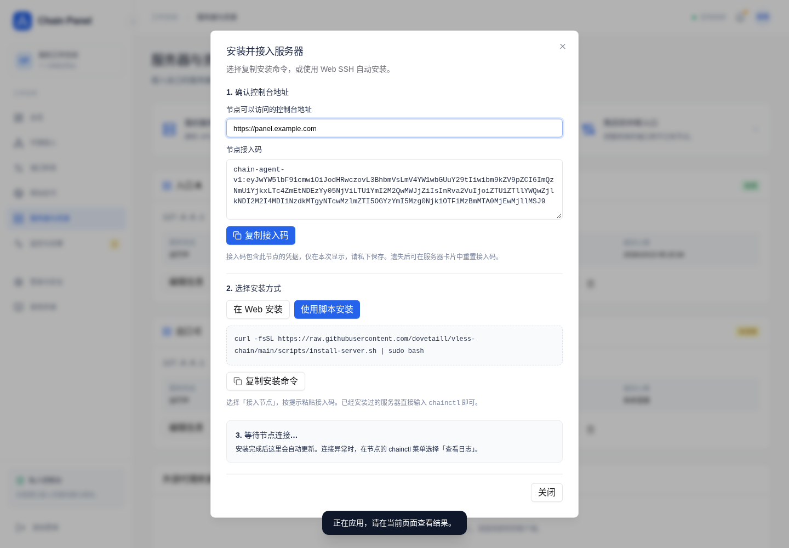

Agent 负责接收配置、监听业务端口和上报流量，通常只安装一次。**SSH 只是可选的自动安装方式**；日常管理由 Agent 主动连接控制台，无需再次 SSH。Web SSH 支持核对指纹后使用 root 密码或无口令私钥，凭据只用于当次安装。

「高级：REALITY 伪装站点」默认域名 `www.microsoft.com`、端口 `443`，地址和端口各自填写。REALITY 目标通常是 HTTPS 服务，**并非协议规定只能 443**。伪装目标端口与客户端连接的监听端口是两回事，普通单机端口转发不需要改这些设置。

### 我只有代理链接

选择「已有代理」，粘贴完整链接。可以直接复制给客户端，也能在自己的线路里将它选为外部出口。无法也无需在对方服务器安装 Agent。

### 服务商只给了一个转发端口

通常提供的是“服务商入口 IP:端口 → 你指定的目标”，它本身不是一个带账号的代理：

- 有完整原节点链接：选择「购买的中转入口」，填写原链接、服务商入口地址和端口。平台替换连接端点，保留 UUID/密码及原 TLS/REALITY 参数。
- 中转到你自己的代理：在代理编辑窗口展开「使用购买的中转入口」，填写服务商入口。导出的链接和配置随之更新。
- 只转发 SSH/数据库：在服务商处把端口映射到目标服务，然后直接用原业务客户端访问该入口；不需要生成代理账号。

你仍需在服务商处配置映射，并确认它支持 TCP、UDP 中的哪些协议。只有一个端口时可以使用该端口跑支持的代理协议；并不意味着能随意复用多个互不兼容的监听服务。

## 5. 创建代理与导入客户端

1. 「代理接入」→「创建代理」。
2. 输入名称，选择入口服务器、协议；监听端口可自动分配。
3. 默认由入口直接出网。多跳时展开「经过其他服务器」，按顺序添加。
4. 保存并应用。成功后点击该行「接入」。

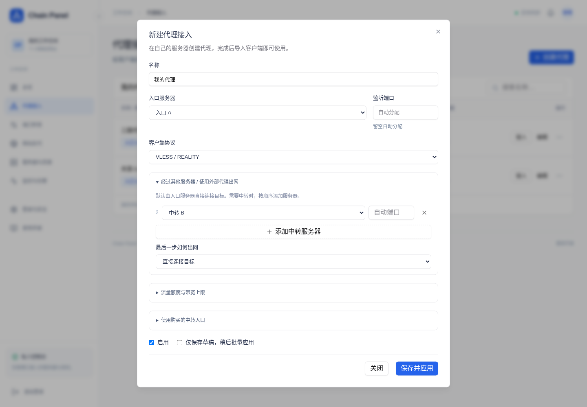

| 协议 | 当前受管入口 | 凭据与注意点 |
| --- | --- | --- |
| VLESS / REALITY | TCP + Vision | 自动生成 UUID、密钥、short ID |
| HTTP 代理 | HTTP / CONNECT | 用户名密码；普通入口不加密 |
| SOCKS5 | TCP、认证后的 UDP ASSOCIATE | 用户名密码；UDP 需同时放行 |
| Shadowsocks 2022 | TCP、UDP，2022-blake3-aes-128-gcm | 自动生成密钥，客户端需支持 SS2022 |
| Trojan / TLS | TCP/TLS，含协议内 UDP | 自动生成密码，需要域名和证书 |

外部出口可导入 HTTP(S)、SOCKS5、SS（常规 SIP002 或旧式 base64）、Trojan TCP/TLS，以及原有 VLESS TCP/raw、XHTTP TLS/REALITY 链接。当前不支持 SS 插件、Trojan WebSocket 等所有扩展组合；不支持的链接会报错。WebSocket 网站反代与代理协议的 WebSocket 传输不是同一功能。

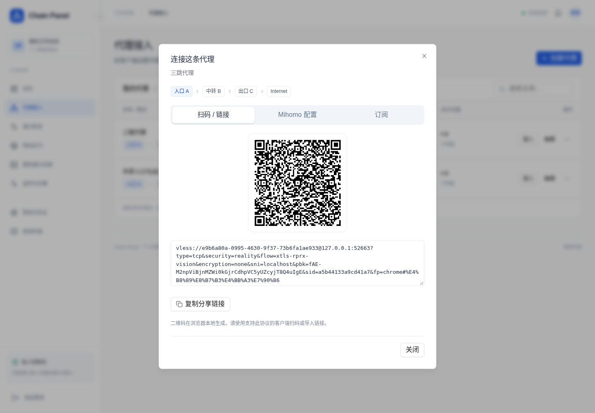

「接入」提供：

- **扫码 / 链接**：二维码在本地浏览器生成，不发送给第三方。
- **Mihomo 配置**：可直接导入的完整 YAML，或用于合并的节点 YAML。使用支持相应协议的 Mihomo / Clash Meta 客户端。
- **订阅**：为当前代理生成独立链接，随已应用配置更新；在「登录与安全」撤销。API 也支持一个订阅选取多条代理。

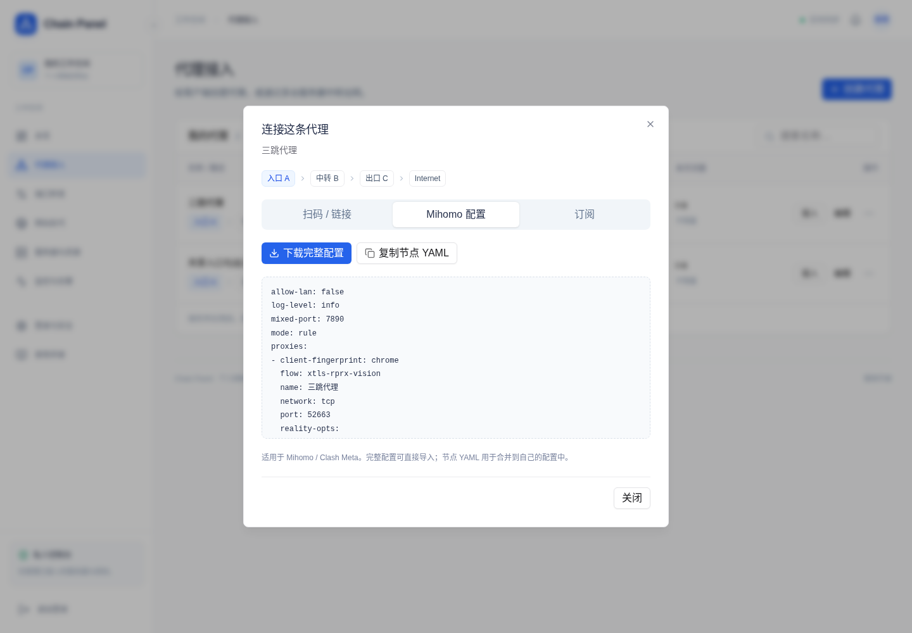

订阅 URL 包含访问凭据，请像代理密码一样保存。撤销订阅会阻止后续下载，已下载的节点凭据仍有效。草稿、停用或已删除的线路不会被当作可用节点导出。

## 6. 普通 TCP / UDP 端口转发

例如希望连接 `A:20000` 就能访问 `B:3306`：

1. 「端口转发」→「创建转发」。
2. 入口选择服务器 A，监听端口填 `20000`。
3. 目标地址单独填 B 的 IP，目标端口填 `3306`。
4. 数据库、SSH 通常选 TCP；游戏、DNS 按业务选 UDP；需要两者时选 TCP + UDP。
5. 保存并应用，从「接入」复制地址。数据库用户名密码仍使用 B 原来的凭据。

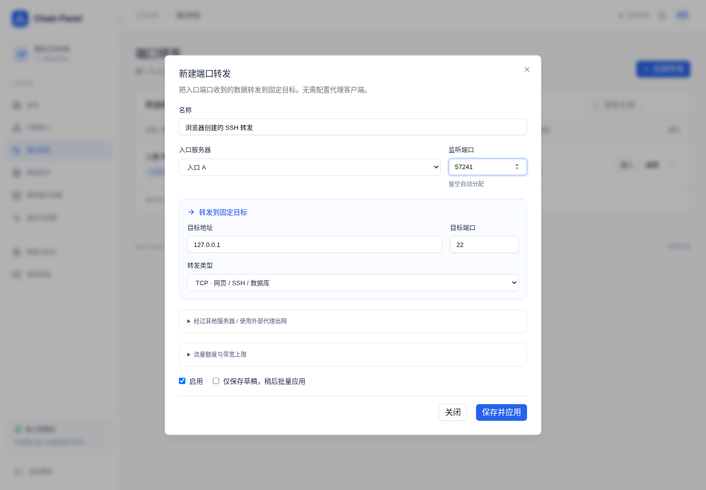

目标必须从最后一台转发服务器可达。填 `127.0.0.1` 指最后一台服务器自身，不是你的电脑。普通转发不自动解决 NAT 穿透；家庭内网需有可达隧道或入站映射。入口和内部中转端口需要放行防火墙及云安全组。

多服务器路径按「A → B → C」添加，中间协议由平台处理。固定端口转发会透传原业务数据，HTTP 代理与 SOCKS5 则适用于客户端需要自己选择目标的场景。

## 7. 网站、HTTPS 与 WebSocket

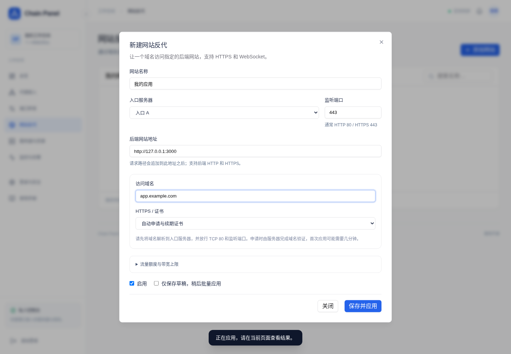

「网站反代」填写入口服务器、监听端口、访问域名和后端 URL，例如 `http://127.0.0.1:3000`。后端 URL 保留完整形式，因为它还可包含路径前缀。请求路径与查询会转交后端，支持 WebSocket 升级。多个域名可共享同一服务器的同一网站端口，TLS 模式必须一致。

证书方式：

- **自动申请与续期**：域名直接解析到入口，TCP 80 必须可供本 Agent 使用，HTTPS 监听端口也需放行。Agent 通过 Certbot webroot 申请，每 12 小时检查续期，失败显示告警。
- **自己的证书**：粘贴 PEM 证书链和对应私钥，证书须覆盖域名。
- **HTTP**：不启用 HTTPS，适合已有外层反代或可信内网。

若同机的控制台 Nginx 已占用 80/443，Agent 不会接管它。可以选另一台入口服务器，或用自己的证书与空闲端口；已有 Nginx 也可反代到 HTTP 网站规则。自动证书的 80 入口只提供域名验证，不自动建立网站的 HTTP 跳转规则。

手工 HTTPS、域名路由和 WebSocket 已有真实本机集成测试；公网证书签发仍取决于域名解析、端口可达与证书机构，不能由本机测试替代。

## 8. 流量、月额度与带宽上限

在任意规则编辑窗口展开「流量额度与带宽上限」：

| 设置 | 单位 | 执行方式 |
| --- | --- | --- |
| 上传上限 | Mbps | 客户端发往入口，所有连接合计 |
| 下载上限 | Mbps | 入口发往客户端，所有连接合计 |
| 月流量额度 | GiB | 上传＋下载，用尽停止传输 |
| 留空 | — | 不限制该项 |

例如下载上限 `10 Mbps`，理论约为 `1.25 MB/s`；实际会有协议开销。速度限制由数据通路持续调度，不是看到监控超标后偶尔断开连接。TCP 与 UDP 共用对应方向的预算，多开连接不能把上限成倍放大。限速不会修改整机网卡规则，也不会把其他线路一起限速。

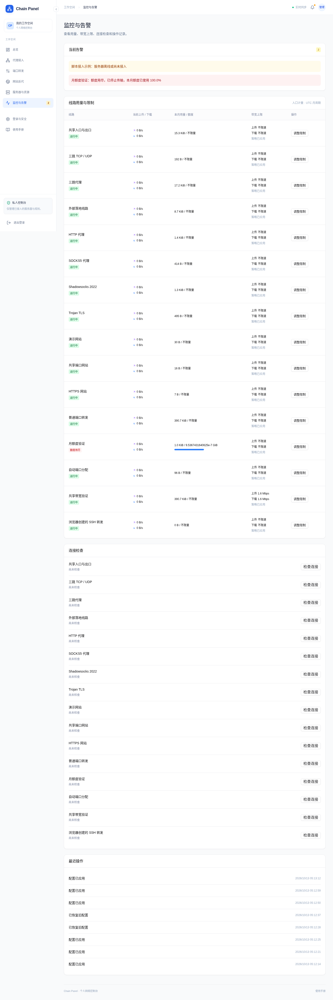

月额度每月 1 日 **UTC** 自动重置，上下行相加。计量放在客户端接入层，中间跳不重复扣同一线路的额度；流量可包含代理协议开销，网站按请求/响应体和 WebSocket 数据计量，不能当作运营商账单。线路记录保存近 35 天日用量，总览展示近七天。

Agent 大约每 2 秒持久化并上报，正常重启会保存计数；突然断电最多可能丢失最近一个采样周期。控制台离线时，Agent 继续执行本地限速和额度。入口更换到另一台服务器会使用那台 Agent 的本地账本，当前不合并不同入口机器的历史月额度。

额度达到 80%、95% 与耗尽时显示提醒；还显示服务器离线、运行错误、证书续期失败和最近连接检查失败。连接检查按需运行，TCP 成功只表示端口可连接；整链 HTTP 检查才会发送实际请求。TCP/UDP 回显检查要求目标本身是回显服务。

只修改限速或额度，可在线更新；修改端口、路径、协议或证书会重新应用受影响实例，共享线路可能短暂重连。保存后的策略在应用成功前不会被标成已生效。

## 9. 登录安全与恢复

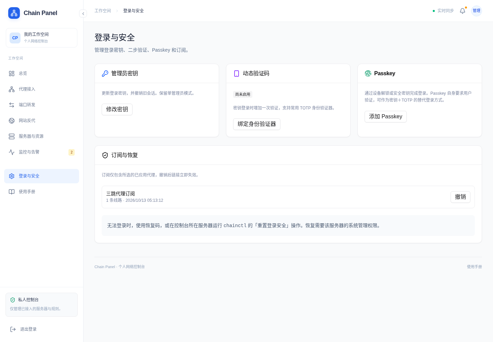

- **管理员密钥**：验证当前密钥后输入至少 32 字符的新值，或留空生成。旧密钥和旧会话失效，新密钥仅当次显示。
- **TOTP**：验证当前密钥，扫码并输入六位验证码完成绑定，保存十个一次性恢复码。之后密钥登录还需动态码或恢复码；同一动态码不能重复使用。
- **Passkey**：使用固定 HTTPS 域名绑定设备或安全密钥，需设备用户验证，可独立替代密钥＋TOTP 登录。本机开发允许 `http://localhost`。更换域名前先处理旧域名凭据。
- **订阅**：查看已创建订阅并撤销。

无法使用验证器时先用恢复码。拥有控制台服务器系统权限时：

```bash
sudo chainctl reset-auth
```

输入 `RESET` 后，工具备份数据库、清除 TOTP / Passkey 并重启原先运行的控制台；保留管理员密钥、代理规则和订阅。找不到密钥可运行 `sudo chainctl token`。这类本地恢复操作要求主机管理权限。

## 10. 手机操作与故障处理

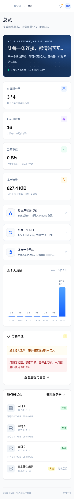

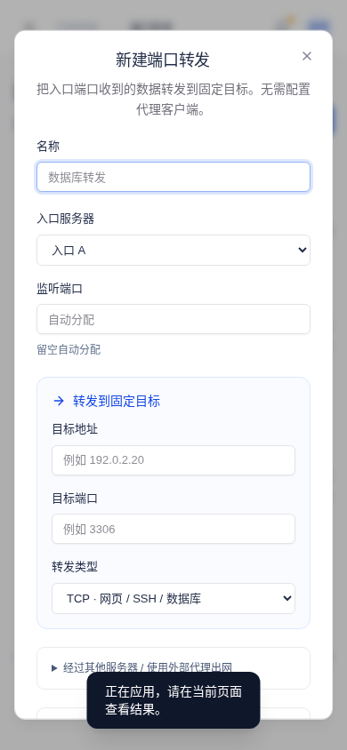

遇到问题依次检查：服务器在线 → 规则已应用 → 额度未耗尽 → 监听端口与云安全组 → 目标可达 → 客户端支持协议。规则的「更多操作 → 检查连接」提供检查入口；「监控与告警」保留结果和应用记录。

应用失败会尝试恢复旧配置；离线节点尚未确认恢复时会明确显示，而不会把保存成功等同于运行成功。原有 SSH 脚本的服务仍独立运行。

[高级部署与开发](docs/advanced.md) · [原有 SSH 脚本指南](../SSH-GUIDE.md) · [主题来源与许可](frontend/THEME.md)
